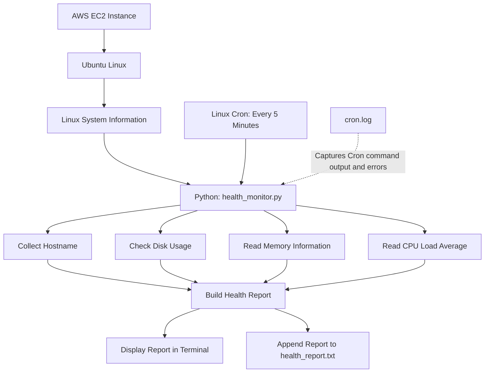
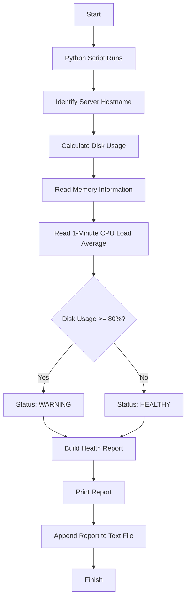

# AWS EC2 Server Health Monitor 🖥️

A beginner-friendly Python and DevOps project that monitors the basic health of an Ubuntu Linux server running on AWS EC2. It collects system information, displays a health report, saves reports to a file, and runs automatically every five minutes using Linux Cron.

This project is designed to help beginners learn **Python, Linux, AWS EC2, automation, Git, and GitHub** through a practical hands-on example.

---

## 📑 Table of Contents

1. [Project Overview](#-project-overview)
2. [Why This Project?](#-why-this-project)
3. [Architecture Diagram](#-architecture-diagram)
4. [How the Project Works](#-how-the-project-works)
5. [Technologies Used](#-technologies-used)
6. [Project Folder Structure](#-project-folder-structure)
7. [Prerequisites](#-prerequisites)
8. [Step-by-Step Setup](#-step-by-step-setup)
9. [Understanding the Python Script](#-understanding-the-python-script)
10. [Sample Output](#-sample-output)
11. [Automated Monitoring with Cron](#-automated-monitoring-with-cron)
12. [Verify the Automation](#-verify-the-automation)
13. [Important Linux Commands](#-important-linux-commands)
14. [Git and GitHub](#-git-and-github)
15. [Troubleshooting](#-troubleshooting)
16. [Limitations and Future Improvements](#-limitations-and-future-improvements)
17. [Learning Outcomes](#-learning-outcomes)

---

## 🎯 Project Overview

The AWS EC2 Server Health Monitor is a Python script that collects basic system information from an Ubuntu server.

It monitors:

- **Server hostname:** Identifies the machine running the script.
- **Disk usage:** Calculates total, used, and available disk space.
- **Memory usage:** Reads Linux memory information and calculates memory utilization.
- **CPU load average:** Displays the one-minute system load average.
- **Disk health status:** Displays `HEALTHY` or `WARNING` based on a disk usage threshold.
- **Report generation:** Displays the report in the terminal and saves it to a text file.
- **Scheduled execution:** Uses Linux Cron to run the script automatically every five minutes.

The script is intended for learning and basic system monitoring, not as a replacement for a production monitoring platform.

## 💡 Why This Project?

Imagine you manage an AWS EC2 server. You want to know whether its disk is becoming full, how much memory is being used, and whether the system is under load.

Instead of manually checking the server every day, you can use Python to collect the information and Cron to run the script automatically.

This project demonstrates a simple form of **DevOps automation**: using code and scheduled jobs to perform repetitive operational tasks.

## 🏗️ Architecture Diagram

The following diagram shows how the project components work together.



### Architecture explained

1. **AWS EC2:** Provides the virtual server.
2. **Ubuntu Linux:** The operating system where the script runs.
3. **Python script:** Collects the server's system information.
4. **Health report:** Combines the collected values into a readable report.
5. **`health_report.txt`:** Stores reports generated by the script.
6. **Linux Cron:** Starts the script automatically every five minutes.
7. **`cron.log`:** Captures the script's standard output and error output from the scheduled command.

> Note: `cron.log` is a command-output log, while `health_report.txt` contains the formatted health reports produced by the Python script.

## 🔄 How the Project Works



The current disk threshold is **80%**. The script reports `WARNING` when disk usage is 80% or higher; otherwise, it reports `HEALTHY`.

The memory percentage and CPU load average are displayed as information. They do not currently determine the health status.

## 🛠️ Technologies Used

| Technology | Purpose |
|---|---|
| AWS EC2 | Hosts the virtual server |
| Ubuntu Linux | Operating system |
| Python 3 | Collects and processes system information |
| Python `os` module | Retrieves hostname and CPU load average |
| Python `shutil` module | Retrieves disk usage |
| Linux `/proc/meminfo` | Provides memory information |
| Python file handling | Writes health reports to a file |
| Linux Cron | Schedules automatic execution |
| Git | Tracks changes to project files |
| GitHub | Stores and shares the project source code |

## 📁 Project Folder Structure

```text
Python-Linux-AWS-DevOps/
│
├── .venv/                           # Python virtual environment
│
└── 05-Projects/
    │
    └── server-health-monitor/
        │
        ├── health_monitor.py        # Main Python script
        ├── README.md                # Project documentation
        ├── .gitignore               # Files Git should ignore
        ├── health_report.txt        # Generated health reports
        └── cron.log                 # Scheduled command output
```

**Important:** The generated report and log files are runtime files. They should normally be excluded from Git so that the repository contains the source code and documentation rather than continuously changing output files.

The `.venv` directory is stored at the main learning-project level and is not part of this project's Git repository.

## ✅ Prerequisites

Before starting, make sure you have:

- An AWS EC2 instance running Ubuntu Linux.
- SSH access to the EC2 instance.
- Python 3 installed.
- Git installed.
- A GitHub account.
- Basic familiarity with terminal commands.

Check the installed versions:

```bash
python3 --version
git --version
```

Check that Cron is running:

```bash
sudo systemctl status cron --no-pager
```

If the status shows `active (running)`, the Cron service is running.

## 🚀 Step-by-Step Setup

### Step 1: Connect to the EC2 instance

Connect to your Ubuntu server using SSH or your preferred EC2 connection method.

Once connected, your terminal should show a prompt similar to:

```text
pythonlearner@ip-172-31-2-84:~$
```

The hostname and username may differ on other servers.

### Step 2: Navigate to the project directory

```bash
cd ~/Python-Linux-AWS-DevOps/05-Projects/server-health-monitor
```

Check the current directory:

```bash
pwd
```

List the project files:

```bash
ls -la
```

### Step 3: Activate the Python virtual environment

This project uses a virtual environment located in the main learning directory.

```bash
source ~/Python-Linux-AWS-DevOps/.venv/bin/activate
```

When the environment is active, the terminal prompt normally displays `(.venv)`.

**Why use a virtual environment?**

A virtual environment isolates Python packages from other Python projects. It helps keep project dependencies organized.

### Step 4: Run the monitoring script

```bash
python health_monitor.py
```

The script collects system information, displays a health report, and appends the report to `health_report.txt`.

### Step 5: View the generated report

```bash
cat health_report.txt
```

To see the most recent report:

```bash
tail -n 20 health_report.txt
```

Because the script uses append mode, every successful run adds another report to the file.

## 🧠 Understanding the Python Script

The main file is `health_monitor.py`.

### 1. Import Python modules

```python
import os
import shutil
from datetime import datetime
```

- `os`: Provides operating-system information and functions.
- `shutil`: Provides utilities such as disk usage information.
- `datetime`: Provides date and time information for the report.

These are Python standard-library modules, so they do not normally require separate installation.

### 2. Identify the server

```python
server_name = os.uname().nodename
```

This retrieves the system's hostname, helping identify which server produced the report.

### 3. Check disk usage

```python
disk = shutil.disk_usage("/")
```

The `/` path represents the root filesystem. The returned values include total capacity, used space, and free space in bytes.

The script converts those values into gigabytes and calculates the percentage of disk space used.

### 4. Read memory information

```python
with open("/proc/meminfo", "r") as file:
    memory_data = file.readlines()
```

Linux exposes memory statistics through `/proc/meminfo`. The script reads the relevant values and calculates memory usage using total memory and available memory.

### 5. Read CPU load average

```python
cpu_load = os.getloadavg()[0]
```

This retrieves the one-minute load average.

**Important distinction:** CPU load average is not the same as CPU utilization percentage. Load average represents the system's average runnable and uninterruptible workload over a time interval. Its interpretation depends partly on the number of CPU cores and the workload.

### 6. Determine disk health status

```python
if disk_percent >= 80:
    status = "WARNING"
else:
    status = "HEALTHY"
```

This condition compares disk usage with the configured threshold.

- Below 80%: `HEALTHY`
- At or above 80%: `WARNING`

This is a simple disk threshold check, not a complete health assessment of the server.

### 7. Save the report

```python
with open("health_report.txt", "a") as file:
    file.write(report + "\n")
```

The `"a"` mode means **append**. It adds the new report to the end of the existing file instead of replacing previous reports.

## 📊 Sample Output

The actual numbers change depending on your EC2 instance's current resource usage. A report may look like this:

```text
====================================
SERVER HEALTH REPORT
====================================
Date       : 2026-10-28 ...
Server     : ip-172-31-2-84

Disk Total : 6.61 GB
Disk Used  : 2.58 GB
Disk Usage : 38.98%

Memory Usage : 38.50%
CPU Load Avg : 0.05

Disk Status : HEALTHY
====================================

Report saved to health_report.txt
```

The values above are illustrative, based on an example run; they are not live measurements.

## ⏰ Automated Monitoring with Cron

Linux Cron is a scheduler that runs commands at specified times. It allows the health-monitoring script to run without manually executing it each time.

### Step 1: Open your user crontab

```bash
crontab -e
```

If prompted to choose an editor, select the editor you are comfortable using.

### Step 2: Add the scheduled job

Add this line:

```cron
*/5 * * * * cd /home/pythonlearner/Python-Linux-AWS-DevOps/05-Projects/server-health-monitor && /home/pythonlearner/Python-Linux-AWS-DevOps/.venv/bin/python health_monitor.py >> cron.log 2>&1
```

This command uses absolute paths so Cron can find the project and Python interpreter reliably.

**Understand the schedule:**

```text
*/5 * * * * command
 │  │ │ │ │
 │  │ │ │ └── Day of week
 │  │ │ └──── Month
 │  │ └────── Day of month
 │  └──────── Hour
 └─────────── Every 5 minutes
```

`*/5` in the minute field means every five minutes.

### Step 3: Understand the command

| Part | Meaning |
|---|---|
| `*/5 * * * *` | Run every five minutes |
| `cd /home/.../server-health-monitor` | Enter the project directory |
| `&&` | Run the next command only if the directory change succeeds |
| `.venv/bin/python` | Use the project's virtual-environment Python interpreter |
| `health_monitor.py` | Execute the monitoring script |
| `>> cron.log` | Append standard output to the log file |
| `2>&1` | Redirect standard error to the same log destination |

The Cron entry runs under the user whose crontab contains it. It does not need `sudo` for this script under normal permissions.

### Step 4: Verify the scheduled job

```bash
crontab -l
```

You should see the scheduled command listed.

Check the Cron service:

```bash
sudo systemctl status cron --no-pager
```

## 🔍 Verify the Automation

Wait for the next five-minute interval, then inspect the generated files.

### Check the health reports

```bash
tail -n 30 health_report.txt
```

### Check the Cron command log

```bash
tail -n 30 cron.log
```

### Check Cron activity in system logs

```bash
sudo grep CRON /var/log/syslog | tail -n 30
```

If your Ubuntu configuration uses a different logging setup, Cron messages may be available elsewhere.

### Test the script manually

```bash
python health_monitor.py
```

Running it manually is useful for checking the script before relying on the schedule.

## 🐧 Important Linux Commands

| Command | Purpose |
|---|---|
| `pwd` | Display the current directory |
| `ls -la` | List files, including hidden files |
| `cd path` | Change directories |
| `cat health_report.txt` | Display the report file |
| `tail -n 20 health_report.txt` | Display the last 20 lines |
| `crontab -l` | List scheduled jobs for the current user |
| `crontab -e` | Edit the current user's scheduled jobs |
| `sudo systemctl status cron` | Check the Cron service |
| `sudo grep CRON /var/log/syslog` | Search system logs for Cron activity |
| `git status` | Check Git working-tree changes |

## 🌐 Git and GitHub

Git tracks source-code changes locally. GitHub hosts the Git repository online so you can share the project and use it as part of your learning portfolio.

### Files to include

- `health_monitor.py`
- `README.md`
- `.gitignore`

### Files to exclude

- `.venv/`
- `health_report.txt`
- `cron.log`
- `__pycache__/`
- `.env` and any files containing secrets

Your `.gitignore` should include:

```gitignore
# Python virtual environments
.venv/
venv/

# Python cache
__pycache__/
*.py[cod]

# Generated reports and logs
health_report.txt
cron.log

# Secrets and environment files
.env
```

### Push the project to GitHub

If the Git repository and SSH remote have already been configured, run:

```bash
git status
git add health_monitor.py README.md .gitignore
git commit -m "Improve project documentation"
git push
```

If Git reports that there is nothing to commit, the files may already be committed. Check `git status` before making another commit.

The repository URL for this project is intended to be:

https://github.com/santhosh2958-dot/aws-ec2-server-health-monitor

The repository must exist on GitHub and you must have access to it before pushing successfully.

## 🛠️ Troubleshooting

### Problem 1: `python: command not found`

Check Python:

```bash
python3 --version
```

Activate your virtual environment:

```bash
source ~/Python-Linux-AWS-DevOps/.venv/bin/activate
```

Then try:

```bash
python health_monitor.py
```

### Problem 2: `No such file or directory`

Check that you are in the project directory:

```bash
cd ~/Python-Linux-AWS-DevOps/05-Projects/server-health-monitor
pwd
ls -la
```

### Problem 3: Cron does not generate a report

Check the configured job:

```bash
crontab -l
```

Check that Cron is running:

```bash
sudo systemctl status cron --no-pager
```

Inspect the log:

```bash
tail -n 50 cron.log
```

Confirm that the paths in the crontab point to the actual project directory and Python interpreter.

### Problem 4: GitHub says `Repository not found`

Check that the repository exists under the expected GitHub account:

https://github.com/santhosh2958-dot/aws-ec2-server-health-monitor

Check the configured remote:

```bash
git remote -v
```

Check SSH authentication:

```bash
ssh -T git@github.com
```

Successful SSH authentication does not guarantee that the target repository exists or that your account has permission to access it.

### Problem 5: The health report is not updated immediately

Cron runs at scheduled intervals. Wait until the next five-minute run, or execute the script manually to generate a report immediately.

## ⚠️ Limitations and Future Improvements

### Current limitations

- The script monitors the root filesystem (`/`) only.
- The health status is based on disk usage only.
- Memory utilization and CPU load average are displayed but do not trigger warnings.
- CPU load average is not CPU usage percentage.
- Reports and logs can grow indefinitely because output is appended.
- The project does not currently send email, SMS, or other notifications.
- It does not provide a dashboard, long-term metrics database, or production-grade alerting.
- If the EC2 instance is stopped, the script and Cron job cannot run while the instance is stopped.

### Possible future improvements

- Add configurable disk and memory warning thresholds.
- Measure CPU utilization percentage over a time interval.
- Add alerts when thresholds are exceeded.
- Rotate or limit the size of report and log files.
- Monitor multiple filesystems.
- Export metrics to Amazon CloudWatch.
- Add automated tests.
- Run the script through a service manager or container where appropriate.

These improvements can be added incrementally as your Linux, Python, and AWS skills develop.

## 🎓 Learning Outcomes

After completing this project, you should understand the basics of:

- Creating and running Python scripts on Ubuntu.
- Using Python modules to collect operating-system information.
- Reading system information from `/proc`.
- Calculating disk and memory utilization.
- Using conditional statements to determine a status.
- Writing reports to text files.
- Creating and verifying Linux Cron jobs.
- Troubleshooting scheduled tasks using logs.
- Using Git to track changes.
- Publishing a project to GitHub.
- Understanding how small automation tasks support DevOps workflows.

---

## 👨‍💻 Author

**Santhosh Kumar**

Beginner-friendly hands-on project for learning Python, Linux, AWS EC2, and DevOps automation.

---

**Disclaimer:** This project is intended for educational purposes. It provides basic server information and should not be considered a complete monitoring or alerting solution for production environments.
